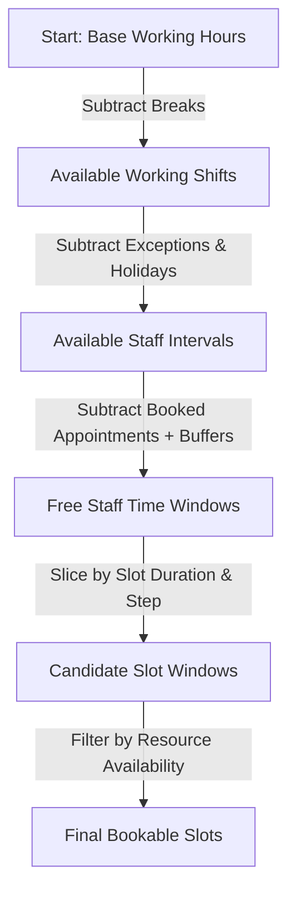

# BooklyHub — Scheduling & Availability Engine

## 1. Engine Design: Interval Algebra vs Brute Force

Traditional booking systems compute available slots by iterating minute-by-minute over the entire calendar day (e.g., checking 10:00, 10:01, 10:02...). For busy multi-staff clinics or gyms, this brute-force approach leads to severe CPU thrashing and unbounded database roundtrips.

**BooklyHub** employs a deterministic **Interval-Based Scheduling Engine (`IAvailabilityService`)** powered by pure interval algebra (`TimeInterval`):

---

## 2. Core Availability Components

### 2.1 Interval Algebra (`TimeInterval.cs`)
An interval represents a half-open time range `[Start, End)`. The scheduling engine operates on collections of intervals:
- **`Subtract(busyInterval)`**: Cuts a busy period out of a free window, potentially splitting one free window into two smaller windows.
- **`OverlapsWith(other)`**: `Start < other.End && End > other.Start`.
- **`Duration`**: `End - Start`.

### 2.2 Buffer Times (`BufferBefore` & `BufferAfter`)
Services frequently require prep or cleanup periods (e.g., 10 minutes room sterilization for a dental procedure). When an appointment is booked from `10:00` to `10:30` with `BufferBefore = 5` and `BufferAfter = 10`, the scheduling engine treats the staff member as unavailable from `09:55` to `10:40`.

### 2.3 Shared Resource Constraints
A service can require one or more physical resources from a `ResourceGroup` (e.g., a "Treatment Room" or "Ultrasound Machine"):
1. The engine checks staff availability first.
2. For each candidate time slot, it verifies whether at least `QuantityRequired` active units in the required `ResourceGroup` are unallocated during that exact window.
3. If no resource is free, the slot is pruned from the result.

---

## 3. Daylight Saving Time (DST) & Timezone Safety

All internal database timestamps (`StartAtUtc`, `EndAtUtc`, `CreatedAtUtc`) are stored strictly in **UTC**.

The columns are `datetime2`, which stores the ticks it is handed and converts nothing, so the label a value carries on
the way in is the only thing that says which instant it is. `BL-05` closed that gap at the edge: `UtcInstant.cs` reads
every inbound instant as UTC — an explicit offset is converted back, a value with no designator is taken as the zone
its own field name names — and `Appointment.Create` / `Appointment.Reschedule` refuse a value still labeled for a
machine's zone with the rule `InvalidDateKind`. What is *inside* the engine keeps the opposite convention: the
availability guard builds candidate times from a staff member's local calendar as `Kind=Unspecified` and converts them
with `TimeZoneHelper`, so a refusal there would refuse every booking. The narrowness is the point — `Local` is the one
label that means "these ticks belong to somebody's zone".

The way out is labeled too, and it is not the caller's job: a `datetime2` column hands EF an `Unspecified` value for
every stored instant, so `TIME-01` put `UtcInstantConverter` on the whole model (`ApplicationDbContext.ConfigureConventions`)
and every `DateTime` this context materializes arrives `Kind=Utc` — which is what lets a client trust the `Z` on a read
of `startAtUtc`, not only on the write that produced it.

However, business hours and booking rules are defined in the tenant's or location's **local time zone** (e.g., `America/New_York` or `Europe/London`):

### Conversion Workflow (`TimeZoneHelper.cs`)
1. User requests availability for Date `2026-10-25` in `America/New_York`.
2. The engine resolves `TimeZoneInfo.FindSystemTimeZoneById("America/New_York")`.
3. Shift intervals (e.g. `09:00 - 17:00`) are mapped to local `DateTime` instances on `2026-10-25`.
4. `TimeZoneInfo.ConvertTimeToUtc` converts the shift boundaries to UTC, automatically applying standard/daylight offsets for that specific calendar date.
5. In the event of an ambiguous or invalid local time (e.g. the 1-hour fall-back transition or spring-forward gap), the `TimeZoneHelper` applies deterministic mapping without throwing runtime exceptions.

---

## 4. What each calendar table actually does (`CAL-01`)

`AvailabilityService.LoadCalendarAsync` reads four tables, and each of them has exactly one job in the answer. Until
`CAL-01` the engine could only read one of them, because the other three had no writer in `src`: "the engine enforces
the calendar" and "a manager can maintain the calendar" are two different claims, and this file had been stating the
second on the strength of the first. The table below is the whole of what each one is worth, read off the guard's own
lines — the numbers are `src/BooklyHub.Infrastructure/Services/AvailabilityService.cs` at this tree.

| Table | Read at | What it does | What it does **not** do |
| :--- | :--- | :--- | :--- |
| `Holidays` | `:476`, consumed at `:115-118` (preview) and `:351` (booking guard) | A row whose date falls in the loaded window — **or** a `RecurringAnnually` row whose month and day matches the day being asked about (`:485`) — closes the **whole day** at its scope. `LocationId = null` is the tenant's own closure and applies at every branch; a location row closes that branch alone. This is the only "closed" a manager can write. | It does not narrow to one staff member, and it has no notion of an hour: a holiday is a calendar day, not a window. |
| `WorkingHours` + `WorkingHourInterval` | `:508`, consumed per candidate staff | The staff member's shift windows and breaks for that day of week. Slots are cut inside the shifts and blocked for the breaks, in the location's own zone. | A roster row with no working interval is not "the clinic is closed" — see §4.1. |
| `BusinessHours` | `:517`, consumed only inside the condition at `:559-562` | A **fallback**: when a staff member's roster row carries breaks and *no* working interval, the location's opening hours supply the shift for that day of week. | It does not override a staff member who has a shift, and a row with `IsClosed = true` here does not make the day read `isOpen: false` — the guard filters those rows out, so the day simply stops feeding the fallback. |
| `AvailabilityExceptions` | `:525`, consumed at `:566-568` | A row with `IsAvailable = false` blocks that staff member for its window: vacation, sick leave, a training day. The block removes the covered slots and leaves the rest of the day alone. | A row with `IsAvailable = true` has **no reader at all** — nothing in the guard turns it into extra working time. That asymmetry is why `POST /api/v1/calendar/availability-exceptions` refuses it with `400` instead of storing a row whose promise nobody keeps, and it is the reason `GET /api/v1/calendar/business-hours` exists as the way to add time rather than this table. |

### 4.1 `isOpen: false` means two things, and a missing shift is not one of them

The day shape has four returns and they are not interchangeable:

- `AvailabilityService.cs:105` — the tenant, location or service is not bookable → `isOpen: false`, no slots.
- `:115-118` — the date is in `ClosedDates` (a holiday) → `isOpen: false`, no slots.
- `:120-122` — no candidate staff for this service → `isOpen: true`, `slots: []`.
- `:176` — staff exist, the grid ran, nothing survived → `isOpen: true`, `slots: []` (plus `slotsTruncated`, which only this path can set).

So an unscheduled day and a closed day are different answers, while an unscheduled day and a day with no staff are the
*same* answer. Writing the calendars changes the first pair — a holiday produces the `false` no roster row can — and
changes nothing about the second. `CalendarWriteGuardTests` pins both halves on the same fixture: the day before the
holiday is `isOpen: true` with slots in it, the day after is `isOpen: false` with none, and a roster carrying only a
break stays `isOpen: true` with `slots: []` before its opening hours are written and after an `isClosed: true` week
write takes them away again. A client that treats "no slots" as "closed" is reading a different engine than the one
that answered.

### 4.2 The limits the writers enforce

These are policy numbers chosen in `CAL-01` and stated here because nothing else in the repository picks them:

- **Holidays**: dated at most **today + 3650 days**, name **1..150** characters (the column). A dated holiday *in the
  past* is refused `400` — it closes nothing that is still bookable — while a `RecurringAnnually` row anchored in a
  past year is accepted, because its month and day is what the guard matches. A tenant cannot have two holiday rows on
  one date in the same scope (`422 HolidayAlreadyOnThisDate`); a location row and a tenant row for the same date are
  two different statements and both are allowed.
- **Availability exceptions**: at most **92 days** long, reason **≤ 300** (the column), and its end must still be in
  the future (`422 ExceptionAlreadyPast`). The staff member must belong to the tenant (`404`).
- **The business week**: 1..7 days, one per `DayOfWeek`; both times must lie **inside one day** (`0 ≤ t < 24h`, so a
  `24:00` close is refused rather than folded to midnight), be whole minutes, and `close > open` unless `IsClosed`. The
  write **upserts only the days it names** — a client that sends Monday to Friday must not silently close a clinic's
  Saturday.
- **The two lists** go through the same `Paging` rule as every other paged read (default 20, ceiling 100, offset
  computed in `long`), and the holiday list's window predicate deliberately mirrors the guard's OR, so a recurring row
  whose anchor year is outside the asked window still appears in it.

### 4.3 Which axis each table lives on

`WorkingHourInterval` and `BusinessHour` times are `TimeSpan` values read as **location-local wall times** for the
date being asked about, so §3's conversion runs per day and a DST week gets the offsets its own days have. `Holiday.Date`
is a `DateOnly` — a calendar day in that same zone, with no hour to convert. `AvailabilityException` is the one
calendar table on the **instant** axis (`StartDateTimeUtc` / `EndDateTimeUtc`), which is why its route takes UTC
through the `BL-05` resolver, refuses a value still labelled for a machine's zone, and answers every instant labelled
`Z` like the rest of the read paths (`TIME-01`).
